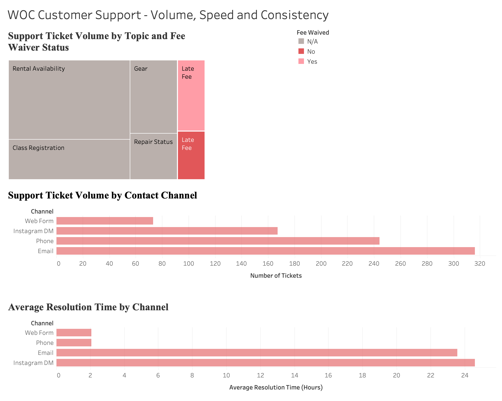

# Milestone 1: Tableau Data Visualization & Support Insights
**Project Track:** Track B — AI & Analytics  
**Client:** Wasatch Outfitters Collective (WOC)  

## 1. Objectives & Dataset Overview
Analyzed `woc_track_b_support.csv` (~800 customer interactions) to diagnose multi-channel customer service bottlenecks, inquiry topics, and fee waiver patterns across Wasatch Outfitters Collective.

## 2. Key Findings & Visual Evidence
* **Channel Bottlenecks:** Email (~316 tickets) and Instagram DM (~167 tickets) drive massive volume, yet take roughly **23.5 to 24.6 hours** on average to resolve[cite: 1, 2, 5]. Meanwhile, Phone (~244 tickets) and Web Form (~73 tickets) average only **~2 hours**[cite: 1, 2, 5].
* **Primary Inquiry Drivers:** **Rental Availability** generates the largest volume of support requests, followed by **Class Registration**, **Gear**, and **Repair Status**[cite: 6].
* **Fee Waiver Consistency:** **Late Fee Disputes** are split between waived (`Yes`) and non-waived (`No`) resolutions, highlighting inconsistent policy enforcement across siloed channels[cite: 6].

## 3. Strategic Implications for Milestone 2
WOC's disconnected channels cause severe delays on asynchronous platforms (Email and Instagram DM)[cite: 2, 5]. Integrating these channels into a centralized CRM and deploying an AI-enabled triage assistant for routine tier-1 inquiries (such as rental availability and class registration)[cite: 6] will dramatically cut resolution times and standardize fee waiver policies.